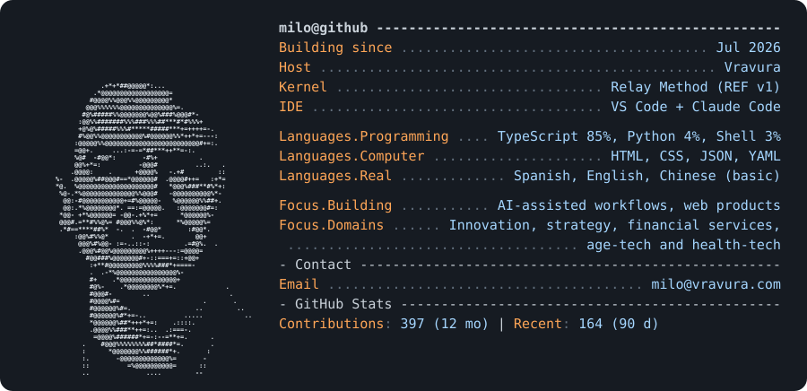

  <picture>
    <source media="(prefers-color-scheme: dark)" srcset="dark_mode.svg">
    <source media="(prefers-color-scheme: light)" srcset="light_mode.svg">
    
  </picture>

### Featured

- **[Relay Method / REF](https://github.com/Milo-ve/relay-entry-format)**: a local, provider-neutral way to hand a task to an AI assistant (or a person) with its boundaries, and get back work a reviewer can assess. Plain files, frozen input snapshots, evidence-bound results, version-bound acceptance. Includes a formal spec (REF v1), CI and tests.

Most of my product code lives in private repos; public write-ups are on the way.

Card generated by [`generate.py`](generate.py) from the GitHub API; the portrait comes from [`make_ascii.py`](make_ascii.py). Run `python3 generate.py` to refresh the stats.
